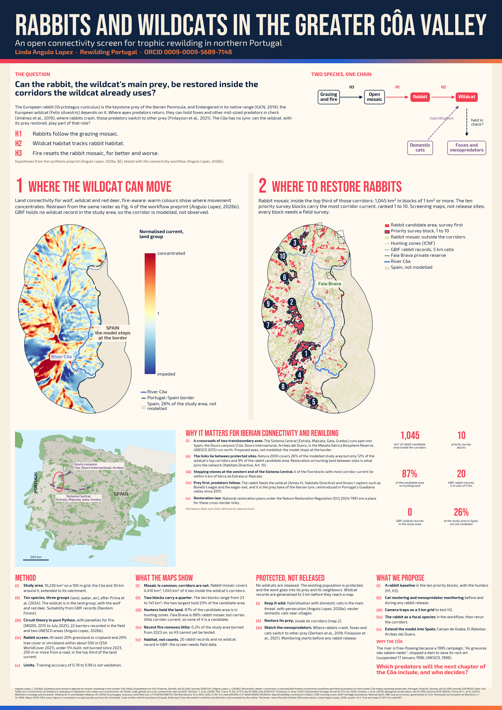

# SER 2027 poster: rabbits and wildcats in the Greater Côa Valley

[](https://doi.org/10.5281/zenodo.23638437)

A poster for the 12th SER World Conference on Ecological Restoration (Lisbon, 30 August to 3 September 2027), thematic series "Lands in Motion". Version 0.2 asks one question: can the European rabbit, the European wildcat's main prey, be restored inside the corridors the wildcat already uses in the Greater Côa Valley, Portugal?



## Files

```
poster/poster.pdf     A0 portrait (841 x 1189 mm), fonts embedded, map rasters at 300 dpi
poster/poster.png     preview, 100 dpi
poster/AnguloLopez_2026_SER2027_poster_v0.2_150dpi.png   high-resolution PNG (print, zoom)
poster/AnguloLopez_2026_SER2027_poster_v0.2_web.png      web PNG, 2000 px wide (sharing)
scripts/poster.py     draws the poster; every figure on it is computed from the data
abstract.md           draft SER abstract
PLAN-v0.2.md          the plan for this version
notes-vr.md           review of v0.1 (PR #2)
codemeta.json         machine-readable metadata (CodeMeta 3.0)
CITATION.cff          citation metadata
```

## Poster summary

The poster tests three hypotheses from the synthesis preprint (Angulo Lopez, 2026a): H1 rabbits follow the grazing mosaic; H2 wildcat habitat tracks rabbit habitat; H3 fire resets the rabbit mosaic, for better and worse. Three maps carry it.

(i) **Where the wildcat can move.** Land connectivity for wolf, wildcat and red deer, redrawn from the raster behind Fig. 4 of the workflow preprint (Angulo Lopez, 2026b). GBIF holds no wildcat record in the study area, so the corridor is modelled, not observed.

(ii) **Where to restore rabbits.** Rabbit mosaic (at least 20% grassland or cropland and 20% tree cover or shrubland within about 500 m, under 5% built, not burned since 2023, 200 m or more from a road) covers 4,410 km². Only 1,045 km² of it lies in the top third of the wildcat's corridors, in ten priority survey blocks, and 87% of that is on hunting land, so a rabbit baseline needs the hunters.

(iii) **Why it matters for Iberian connectivity and rewilding.** A location map of Spain and Portugal with all Natura 2000 sites. (a) The study area is a crossroads of two transboundary axes, the Sistema Central (Estrela, Malcata, Gata, Gredos) and the Douro canyons (Côa, Douro Internacional, Arribes del Duero), drawn as proposed axes, not modelled, because the model stops at the border (26% of the study area lies in Spain, 96% of it without modelled current). (b) Natura 2000 covers 26% of the modelled study area but only 12% of the wildcat's top corridors and 9% of the rabbit candidate area, so restoration on hunting land between sites is what joins the network (Habitats Directive, Art. 10). (c) Four of the five blocks with most corridor current lie within 4 km of Serra da Estrela or Malcata, at the western end of the Sistema Central. (d) The rabbit feeds the wildcat (Annex IV) and Annex I raptors, and it is the prey base of the Iberian lynx, reintroduced in Portugal's Guadiana valley since 2015. (e) National restoration plans under the Nature Restoration Regulation (EU) 2024/1991 are a place for these cross-border links.

The wildcat is protected, not released: neutering of domestic cats near villages, and mesopredator monitoring before any rabbit release. These are screening maps, not release sites. Every block needs a field survey first.

## Rebuild

The poster reads the screening layers from the source repository, [Solo-field-illustrator-project-for-Rewilding-Portugal](https://github.com/coa-connectivity-lab/Solo-field-illustrator-project-for-Rewilding-Portugal), file `research/rewilding-dynamics/scripts/release_candidates.py`. That script reads the [Côa Valley Eco-Connectivity v6](https://www.data.gouv.fr/datasets/coa-valley-eco-connectivity-v6) bundle, ESA WorldCover 2021 and GBIF records generalised to 5 km. The poster also reads EEA Natura 2000 (end-2024), HydroRIVERS and Natural Earth.

To rebuild:
1. Set `SOURCE`, `N2K` and `NE` at the top of `scripts/poster.py` to your copies.
2. Set `BUNDLE`, `GBIF` and `HYDRO` in `release_candidates.py` to your copies.
3. Run:

```bash
conda run -n coa python scripts/poster.py
```

It needs geopandas, rioxarray, rasterio, scipy, matplotlib and Pillow, plus GDAL for the first remote raster fetch. The fonts, Bebas Neue and Exo 2 (both SIL OFL), download on first run.

## Sources

- Angulo Lopez, L. (2026a). Synthesis preprint and research agenda for the Greater Côa Valley (hypotheses H1-H3). Zenodo. <https://doi.org/10.5281/zenodo.22997241>
- Angulo Lopez, L. (2026b). *Movement, Water, Connection: a reproducible Python connectivity workflow and field illustration for the Greater Côa Valley rewilding landscape, Portugal*. Preprint, Zenodo. <https://doi.org/10.5281/zenodo.22979020>
- Workflow: <https://github.com/coa-connectivity-lab/eco-connectivity-workflow>

The full source list is in the poster footer.

## Cite

Angulo Lopez, L. (2026). *Rabbits and wildcats in the Greater Côa Valley: an open connectivity screen for trophic rewilding in northern Portugal* (Version v0.2) [Poster]. 12th SER World Conference on Ecological Restoration, Lisbon. Zenodo. <https://doi.org/10.5281/zenodo.23638437>

The DOI above is the concept DOI: it always resolves to the latest version. Version 0.1 is <https://doi.org/10.5281/zenodo.23638438>.

## Review

Version 0.1 was reviewed by Vance Russell ([VRConservation](https://github.com/VRConservation)) in [pull request #2](https://github.com/coa-connectivity-lab/ser2027/pull/2); the review notes are in `notes-vr.md`, and version 0.2 follows them.

## Licence

Text and maps: CC BY 4.0. Code: MIT. See [LICENSE](LICENSE).

## AI assistance

The code and the first draft of the text were written with Claude (Anthropic), following the author's method and direction, and were reviewed by the author.
